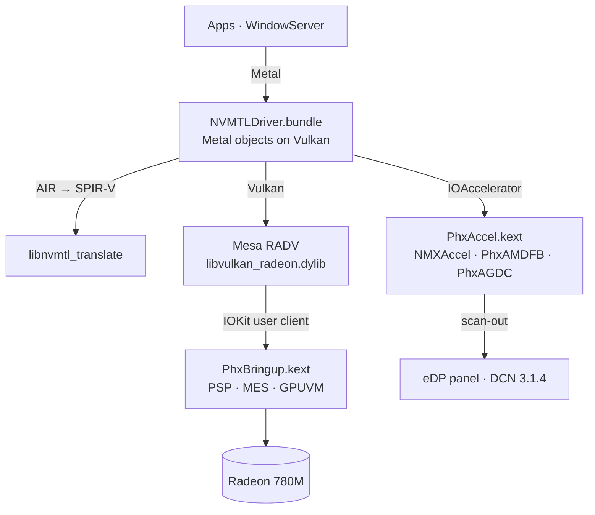

<p align="center">
  <picture>
    <source media="(prefers-color-scheme: dark)" srcset="assets/brand/nullarc-logo-dark.svg">
    
  </picture>
</p>

<p align="center">
  <b>Metal on AMD Radeon 780M (soon also Radeon 740M and 760M) for macOS Tahoe.</b><br>
  GPU bring-up, a display driver WindowServer composites on, and Metal over Vulkan (Mesa RADV)<br>
  for Phoenix / Hawk Point APUs (RDNA 3, GC 11.0.1, gfx1103).
</p>

<p align="center">
  
  
  
  <a href="https://github.com/luuumi-dev/nullarc/actions/workflows/ci.yml"></a>
  <a href="LICENSE"></a>
</p>

<p align="center"><b>English</b> · <a href="README_RU.md">Русский</a></p>

---

## Radeon 760M fork status

This fork adds the supplied HP Envy x360 16-ad0013dx capture (`1002:1900`, revision
`ca`, subsystem `103c:8c6a`): 8 active CUs with physical masks `[0x0f, 0x0f]`, six
physical CU slots per shader array, and enabled RB mask `0x0a`. Captured topology
is validated and transported to RADV through a versioned kernel query. The patched
RADV builds and compiles a gfx1103 compute pipeline in the HP mock; the default
12-CU 780M mock is also checked.

**HP hardware bring-up, GPU execution and Metal acceleration are not verified.**
This branch keeps that exact HP device in diagnostic-only mode: no reference-machine
firmware/register writes, queue submission or display takeover. The capture lacks
IP discovery, memory reservations and firmware validation needed to adapt those
operations. Existing Firebat runtime claims below are retained as upstream reports.

See [development status and test commands](docs/760M_STATUS.md) and
[actual source dependency map](docs/760M_ARCHITECTURE.md). Validate the supplied
profile with `python3 tools/phx_profile.py --check`. Apply Mesa Phoenix patch 0007
after 0001..0006, or use `tools/mesa_phoenix_topology.py` as its alternative.

## Status

Measured on the reference machine — Firebat U6C, Ryzen 7 H 255, Radeon 780M, 2560×1600 120 Hz eDP, macOS Tahoe 26.6.2 —
in October 2026:

| | |
|---|---|
| **Desktop** | WindowServer composites on the 780M at the panel's 120 Hz. CoreAnimation runs at 119–120 fps; dragging a window, 116 fps. |
| **Liquid Glass** | Dock, widgets, Control Center and in-app glass are drawn by the GPU with Apple's own compositor shaders (translated). |
| **Metal in apps** | Every process gets the Metal device, sandboxed WebKit GPU processes included. About 46 apps checked with no crashes, Safari, Chess and Spotify among them. |
| **Display sleep / wake** | Works. |
| **First use of a new effect** | A one-time pause of about 1–3 s while its shader is translated and compiled. After that it comes from the disk cache. |
| **Not yet** | External displays (HDMI, USB-C), hardware video decode/encode, backlight control. |

Other Radeon 780M / 760M machines (Phoenix, Hawk Point) are untested.

## How it works



| Component | Installed in | Source | Role |
|---|---|---|---|
| `PhxBringup.kext` | OpenCore `EFI/OC/Kexts` | [`src/phxbringup`](src/phxbringup) | Loads firmware through the PSP, powers up GFX (SMU/IMU), starts the MES scheduler and the compute and graphics queues, gives every process its own GPUVM address space, implements the BO/submit ABI RADV uses. |
| `PhxAccel.kext` | Auxiliary kernel collection | [`src/phxaccel`](src/phxaccel) | `NMXAccel` IOAccelerator, the `PhxAMDFB` framebuffer (VRAM pool, 120 Hz vblank, frame copy to scan-out) and `PhxAGDC` display control. |
| `NVMTLDriver.bundle` | `/System/Library/CoreServices/CoreTypes.bundle/Contents/Library/PhxGPU`, linked from `/Library/GPUBundles` | [`src/nmplugin`](src/nmplugin) | The Metal driver plugin: Metal on Vulkan, zero-copy IOSurfaces, shader caches. |
| `libvulkan_radeon.dylib` | `PhxGPU/nvmtl` | Mesa + [`mesa-patches-phoenix`](mesa-patches-phoenix) | RADV for gfx1103 with a Darwin winsys. |
| `phxboot` | LaunchDaemon `local.phxboot` | [`tools/phxctl/phxboot.sh`](tools/phxctl/phxboot.sh) | Brings the GPU up at boot before WindowServer opens the panel, with fail-safes that fall back to the firmware framebuffer. |

`libnvmtl_translate.dylib` (Metal AIR → SPIR-V, LGPL-3.0, based on metal2vulkan) ships prebuilt with NullMoth's
plugin; its source is attached to every release. The `NVMTL` prefix is NullMoth's too: none of this is an NVIDIA driver.

## Installing

Download `nullarc-<version>.zip` from the [releases page](https://github.com/luuumi-dev/nullarc/releases) and follow
**[docs/INSTALL.md](docs/INSTALL.md)**. In short: add `PhxBringup.kext` and the boot-args to OpenCore, reboot, run
`sudo ./install.sh --windowserver` from the release folder, reboot twice.

> [!WARNING]
> WindowServer only loads an ad-hoc signed driver with AMFI relaxed (`amfi=0x80`, `amfi_get_out_of_my_way=0x1`).
> That turns library validation off system-wide and FairPlay playback (Apple TV+, Netflix in Safari) stops working.
> `uninstall.sh` and the guide's last section undo everything.

## Building

On the Mac (Command Line Tools, [MacKernelSDK](https://github.com/acidanthera/MacKernelSDK)):

```sh
sh src/phxbringup/build.sh /path/to/MacKernelSDK      # PhxBringup.kext
sh src/phxaccel/build.sh /path/to/MacKernelSDK        # PhxAccel.kext
```

The plugin builds from `src/nmplugin/NVMTLDevice.m`, which includes the rest of `src/nmplugin`. RADV: Mesa
`f5cb8ee0` + Cobalt64's Darwin patches + [`mesa-patches-phoenix`](mesa-patches-phoenix/README.txt).

Unit tests (firmware parsing, IP discovery) run on Linux or macOS and in CI:

```sh
make fixtures   # Phoenix firmware from linux-firmware
make test
```

## Notable fixes

- **Zero-copy IOSurfaces** — textures are linear images over the surface's own pages; WindowServer CPU 77 % → 36 %.
- **Surface keep cache** — CoreAnimation re-wraps the same IOSurfaces every frame; keeping their imports took a dragged window from 64–69 to 116 fps.
- **VRAM pool** — per-allocation contiguous memory fragmented after hours and display wake froze; one 512 MB pool now.
- **RADV mutable descriptor lists** — indexed by the sorted binding order instead of the original one; broke CoreImage blurs and Tahoe's layered icons.
- **Nested loop unrolling (Mesa 0006)** — a new compositor shader variant compiled ~2 s in RADV, one loop level per optimisation round; now ~1 s with identical code.

## The name

**null + arc**: the empty-set sign of a driver that did not exist, its ring opened into an arc.
See the [brand guide](assets/brand/README.md).

## License and credits

Several licenses apply; see [LICENSE](LICENSE), [THIRD_PARTY_NOTICES.md](THIRD_PARTY_NOTICES.md) and [LICENSES/](LICENSES).

- Code written for nullarc (`src/phxbringup`, `tools/phxctl`, …): MIT, or GPL-2.0-only at your option.
- `src/phxaccel`, `src/nmplugin`, `tools/nvmtl-patches`: derived from NullMoth's macOS driver, **PolyForm Noncommercial 1.0.0** — no commercial use.
- `mesa-patches-phoenix`: MIT, as Mesa. Release packages also carry LGPL-3.0 (shader translator), LLVM and AMD firmware; see the notices.

Built on the work of the Linux `amdgpu` team, Mesa, NullMoth, [Cobalt64](https://cobalt64.com),
[Acidanthera](https://github.com/acidanthera) and the AMD-OSX community.
