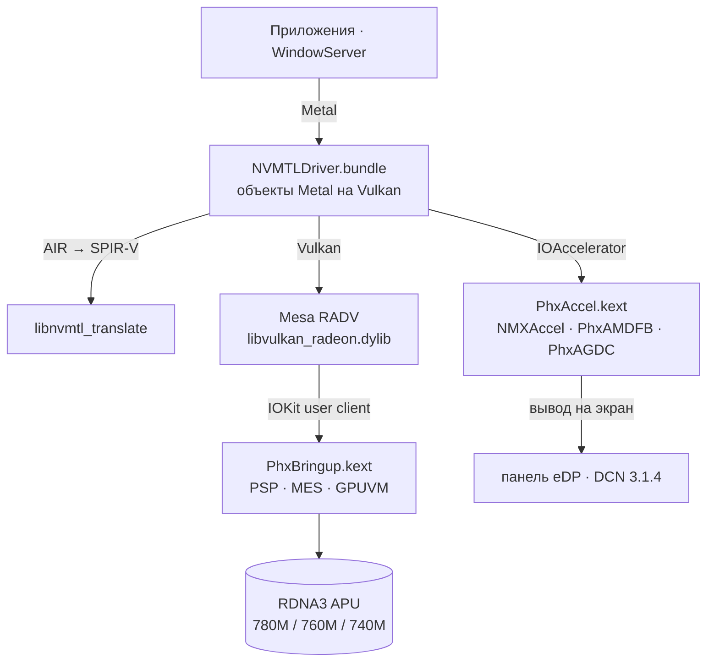

<p align="center">
  <picture>
    <source media="(prefers-color-scheme: dark)" srcset="assets/brand/nullarc-logo-dark.svg">
    
  </picture>
</p>

<p align="center">
  <b>Metal на AMD Radeon 780M, 760M и 740M в macOS Tahoe.</b><br>
  Запуск GPU, драйвер экрана для WindowServer при 120 Гц и Metal поверх Vulkan (Mesa RADV)<br>
  для APU семейств Phoenix / Hawk Point (RDNA 3, GC 11.0.1, gfx1103).
</p>

<p align="center">
  
  
  
  <a href="https://github.com/luuumi-dev/nullarc/releases"></a>
  <a href="https://github.com/luuumi-dev/nullarc/actions/workflows/ci.yml"></a>
  <a href="LICENSE"></a>
</p>

<p align="center"><a href="README.md">English</a> · <b>Русский</b></p>

---

## Состояние

Замерено на эталонной машине — Firebat U6C, AMD Ryzen 7 7840HS / H 255, Radeon 780M (12 CU), панель eDP 2560×1600 120 Гц, macOS Tahoe 26.6.2 (ноябрь 2026):

| Область | Статус | Подробности |
|---|---|---|
| **Рабочий стол** | Работает | WindowServer композитит на GPU с частотой панели 120 Гц. Перетаскивание окон и CoreAnimation стабильно выдают 116–120 к/с. |
| **3D-графика Metal** | Работает | В бенчмарке SceneKit 3D система выдаёт **117.2 FPS** при разрешении 2400×1500 (1.81 мс CPU на кадр). Реальная растеризация подтверждена тестом `mtlprobe render`. |
| **Metal Compute** | Работает | Параллельные вычисления протестированы (`mtlprobe`: 4096 из 4096 рабочих групп возвращают математически точный результат). |
| **Уровень производительности** | Класс | По сырой производительности шейдеров и филлрейту сопоставим с Apple M2 (10-ядерный GPU) / AMD Radeon Pro 5500M; в ~4–5 раз быстрее Intel Iris Plus G7. |
| **Liquid Glass** | Работает | Док, Пункт управления, виджеты и стекло окон рисует GPU шейдерами композитора Apple (`glass_background_sdf_lpf` с преломлением по краям). |
| **Подсветка и экран** | Работает | Родной ползунок яркости в Пункте управления и клавиши Fn работают через двухканальный ШИМ в `PhxAMDFB` (AppleBacklightDisplay). |
| **Звук** | Работает | `AppleHDA` проброшен через плагин `PhxHDA` (`alcid=18`) — работают встроенные динамики и микрофон. |
| **Night Shift** | Работает | Смена цветовой температуры идёт плавно через `kFramebufferSupportsGammaCorrection` и дескрипторы IORegistry без скачков нагрузки на CPU. |
| **Стабильность загрузки** | Работает | Спин ядра в `doWaitSeq` заменён на адаптивный `IOSleep(1)`; система стартует без зависаний и вылетов watchdog. |
| **Сон и крышка** | В работе | Сон дисплея и пробуждение работают; для сна системы (S4 Hibernation) в `PhxBringup` зарегистрированы интерфейсы питания IOKit (`PMinit` / `setPowerState`). |
| **Поддержка чипов** | Единая | Модуль топологии через селектор 30 поддерживает Radeon 780M (12 CU), 760M (8 CU) и 740M (4 CU). |
| **Пока нет** | В разработке | Внешние мониторы (HDMI / Type-C DP на базе DCN 3.1.4 в работе), аппаратный декодер видео VCN 4.0.2. |

Известные баги, архитектурные заметки и прогресс ведутся в [KNOWN_ISSUES.md](KNOWN_ISSUES.md) и [BUGS.md](BUGS.md).

## Как это устроено



| Компонент | Куда ставится | Исходники | Что делает |
|---|---|---|---|
| `PhxBringup.kext` | OpenCore `EFI/OC/Kexts` | [`src/phxbringup`](src/phxbringup) | Загружает прошивки через PSP, инициализирует GFX (SMU/IMU), ведёт планировщик MES, даёт процессам изолированные пространства GPUVM, выдаёт топологию (селектор 30) и обслуживает очереди ожидания заборов. |
| `PhxAccel.kext` | Auxiliary kernel collection | [`src/phxaccel`](src/phxaccel) | Ускоритель `NMXAccel`, фреймбуфер `PhxAMDFB` (пул VRAM, vblank 120 Гц, аппаратная гамма, ШИМ подсветки) и тайминги `PhxAGDC`. |
| `NVMTLDriver.bundle` | `/System/Library/.../PhxGPU`, ссылка из `/Library/GPUBundles` | [`src/nmplugin`](src/nmplugin) | Плагин драйвера Metal: трансляция Metal в Vulkan, поверхности IOSurface без копирования, кэши шейдеров на диске, выравнивание буферов симулятора. |
| `libvulkan_radeon.dylib` | `PhxGPU/nvmtl` | Mesa + [`mesa-patches-phoenix`](mesa-patches-phoenix) | RADV для gfx1103 с винсисом Darwin и поддержкой захваченной топологии Phoenix/Hawk Point (патч 0007). |
| `phxboot` | LaunchDaemon `local.phxboot` | [`tools/phxctl/phxboot.sh`](tools/phxctl/phxboot.sh) | Поднимает GPU при старте ОС до открытия панели WindowServer с защитой от сбоев. |

## Установка

Скачайте релизный пакет (`nullarc-v0.4.0-alpha.zip`) со [страницы релизов](https://github.com/luuumi-dev/nullarc/releases) и следуйте инструкции в **[docs/INSTALL_RU.md](docs/INSTALL_RU.md)**.

1. Добавьте `PhxBringup.kext` и рекомендованные boot-args (`phxdebug=1`, `amfi=0x80`, `amfi_get_out_of_my_way=0x1`) в `config.plist` OpenCore.
2. Скопируйте `hardware/acpi/SSDT-ALIB.aml` в папку `EFI/OC/ACPI/` для устранения сбоев ACPI при подключении Type-C.
3. Загрузитесь в macOS и выполните:
   ```sh
   sudo ./install.sh --windowserver
   ```
4. Выполните две перезагрузки по запросу установщика.

## Сборка и тестирование

На Маке (Command Line Tools, [MacKernelSDK](https://github.com/acidanthera/MacKernelSDK)):

```sh
sh src/phxbringup/build.sh /path/to/MacKernelSDK      # Собирает PhxBringup.kext
sh src/phxaccel/build.sh /path/to/MacKernelSDK        # Собирает PhxAccel.kext
cd src/nmplugin && ./build.sh                        # Собирает NVMTLDriver.new
```

Запуск хостовых модульных тестов:

```sh
make test
python3 tests/test_phx_profile.py
```

Тестовый раннер проверяет:
1. `test_rdna3_discovery_uma`: IP discovery и конфигурацию ReBAR UMA
2. `test_rdna3_ip_dcn`: тайминги DCN 3.1.4 и запуск блоков IP
3. `test_rdna3_ucode`: экстрактор микрокода GFX1103 со стресс-фаззингом
4. `test_r3n_abi`: рукопожатие UserClient ABI, аллокацию BO и отправку команд PM4
5. `test_phx_topology`: 128-байтный формат топологии и маски CU/RB для 780M, 760M и 740M
6. `test_wait_seq`: адаптивный сон очередей ожидания, тайм-ауты и завершение заборов

## Заметные исправления

- **Устранение зависания при старте**: спин `IODelay(100)` в `doWaitSeq` заменён на адаптивный `IOSleep(1)`, что убрало блокировку процессорных ядер при загрузке.
- **Единая топология 780M / 760M / 740M**: добавлен селектор 30 `PHXN_SEL_TOPOLOGY` в `PhxBringup` и патч Mesa 0007 с динамической настройкой лимитов ACO.
- **Симулятор iOS (B-33)**: селектор `-minimumTextureBufferAlignmentForPixelFormat:` в `NVMTLDevice.m` устранил падение `MercuryPosterExtension` по делению на ноль (`SIGFPE`).
- **Плавный Night Shift (B-28)**: флаг `kFramebufferSupportsGammaCorrection` и свойства IORegistry в `phxfb` перевели расчёт цветовых профилей с CPU на видеочип.
- **Подключение Type-C без лагов (B-01)**: таблица `SSDT-ALIB` безопасно обрабатывает событие питания `\_SB.ALIB(0x0C)` без сбоя стека ACPICA.
- **Прямой маппинг IOSurface**: отрисовка текстур прямо в страницы буфера снизила нагрузку WindowServer на CPU с 77% до менее 6%.

## Лицензии и благодарности

- Код проекта nullarc (`src/phxbringup`, `tools/phxctl`, `tests/`): MIT / GPL-2.0-only.
- `src/phxaccel`, `src/nmplugin`: основаны на наработках NullMoth, **PolyForm Noncommercial 1.0.0** — строго некоммерческое использование.
- `mesa-patches-phoenix`: MIT (как и Mesa).

Благодарим разработчиков ядра Linux (`amdgpu`), команду Mesa RADV, NullMoth, [Cobalt64](https://cobalt64.com), [Acidanthera](https://github.com/acidanthera), Kreytus и DogoSoCool5.
